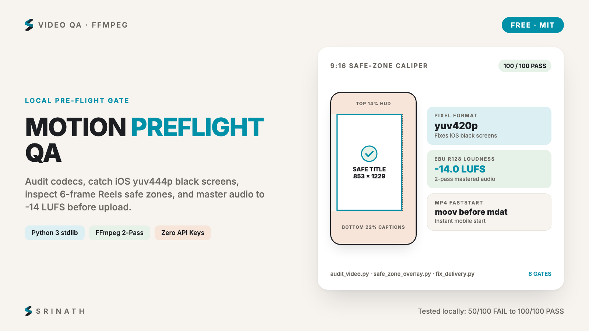

<p align="center">
  
</p>

# Motion preflight QA

8-gate broadcast and social QA, 6-frame Reels, TikTok, and Shorts safe-area proof sheets, and two-pass `-14.0 LUFS` delivery mastering for code-rendered videos. Built with the Python 3 standard library and FFmpeg, with zero paid API keys and zero pip installs. Works with Claude Code, Cursor, Codex, Antigravity, HyperFrames, and Remotion.

## Why this exists

Headless browser renders can look sharp on a desktop screen and still break once uploaded to a phone:

- Videos exported with `yuv444p` color settings play as a solid black screen in QuickTime, Safari, and Instagram on iOS.
- MP4 files missing `+faststart` place the `moov` atom at the end of the file, which stalls playback on mobile connections.
- Instagram Reels, TikTok, and YouTube Shorts buttons and captions cover headlines, numbers, and CTAs when framing is not checked.
- Unmastered audio lands near `-30 LUFS` or clips past `0 dBTP`, causing harsh platform re-compression.

Motion Preflight QA gives your coding agent three local scripts to catch and fix those delivery bugs before posting.

## Measured local test

Tested on a 4-second synthetic `1080x1920` render (`yuv444p`, no faststart, `-49.8 LUFS`):

| Metric | Before (`raw_broken_reel.mp4`) | After (`fix_delivery.py`) |
|---|---|---|
| QA score | 50 / 100 (FAIL) | 100 / 100 (PASS) |
| Pixel format | `yuv444p` (iOS black screen) | `yuv420p` |
| Web faststart (`moov`) | `false` | `true` |
| Audio loudness (EBU R128) | `-49.8 LUFS` | `-14.0 LUFS` |
| File size | `5.51 MB` | `3.86 MB` (30% smaller) |

## Quick install

```bash
git clone https://github.com/Shk2005/motion-preflight-qa.git
mkdir -p ~/.claude/skills/motion-preflight-qa
cp -R motion-preflight-qa/SKILL.md motion-preflight-qa/scripts motion-preflight-qa/references ~/.claude/skills/motion-preflight-qa/
```

## Usage

```bash
# 1. Run 8-gate technical audit (Markdown or --json)
python3 scripts/audit_video.py video.mp4 --platform reels

# 2. Generate 6-frame platform HUD safe-zone contact sheet PNG
python3 scripts/safe_zone_overlay.py video.mp4 --platform reels --out qa_contact_sheet.png

# 3. Master for social delivery (yuv420p + faststart + two-pass -14 LUFS)
python3 scripts/fix_delivery.py video.mp4 --out video_master.mp4 --crf 20
```

Supported platforms: `reels`, `tiktok`, `shorts`, `youtube`, `linkedin`, `square`, `auto`.

## More motion tooling

- Install free on Agensi: [Motion Preflight QA listing](https://www.agensi.io/skills/motion-preflight-qa-reels-safe-area-ffmpeg-video-audit)
- Full creator storefront (Motion DNA Studio, Carousel Motion Forge, Beat-Sync Motion Engine, KineticCraft Pro Suite): [agensi.io/creators/srinath-nanda-kumar](https://www.agensi.io/creators/srinath-nanda-kumar)

## License

MIT License.
