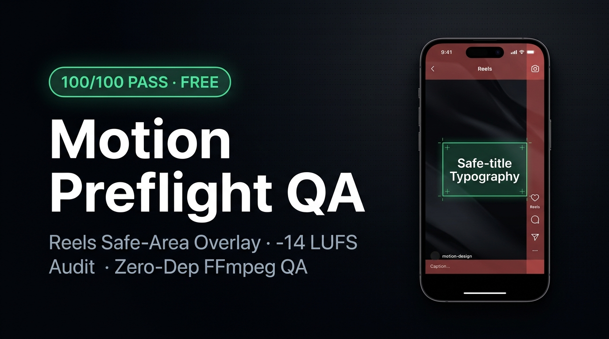

<div align="center">
  

  # Motion Preflight QA

  **Automated 8-gate broadcast & social QA, Reels/TikTok/Shorts safe-area proof sheets, and 2-pass `-14 LUFS` delivery mastering for AI-coded motion graphics.**

  *Zero paid API keys · Zero pip dependencies · Pure Python 3 stdlib + FFmpeg · Works with Claude Code, Cursor, Codex, OpenClaw, HyperFrames & Remotion.*
</div>

---

## Why This Exists

Code-rendered motion graphics look sharp in Chrome — then break on real phones:
- **`yuv444p` pixel format** renders as a solid black screen in QuickTime, Safari, and Instagram iOS.
- **Missing `+faststart`** puts the MP4 `moov` atom at the end of the file, stalling mobile playback.
- **Reels / TikTok / YouTube Shorts UI overlays** silently cover headlines, stats, and CTAs.
- **Unmastered audio** sits at `-30 LUFS` or clips past `0 dBTP`, triggering aggressive platform compression.

**Motion Preflight QA** gives your AI agent (or CI script) three deterministic CLI tools to catch and fix every issue before delivery.

---

## Measured A/B Benchmark

| Metric | Raw Code-Rendered MP4 | After `fix_delivery.py` |
|---|---|---|
| **QA Score** | **50 / 100 (`FAIL`)** | **100 / 100 (`PASS`)** |
| **Pixel Format** | `yuv444p` *(iOS black screen)* | `yuv420p` *(Universal safe)* |
| **Web Faststart (`moov`)** | `false` | `true` |
| **Audio Loudness (EBU R128)** | `-49.8 LUFS` | **`-14.0 LUFS`** |
| **File Size (1080×1920)** | `5.51 MB` | **`3.86 MB`** *(30% smaller)* |

---

## Quick Install

### Claude Code / Cursor / Codex / Antigravity
```bash
git clone https://github.com/Shk2005/motion-preflight-qa.git
mkdir -p ~/.claude/skills/motion-preflight-qa
cp -R motion-preflight-qa/SKILL.md motion-preflight-qa/scripts motion-preflight-qa/references ~/.claude/skills/motion-preflight-qa/
```

### Usage

```bash
# 1. Run 8-gate technical audit (JSON or Markdown)
python3 scripts/audit_video.py video.mp4 --platform reels

# 2. Render 6-frame platform HUD safe-zone contact sheet PNG
python3 scripts/safe_zone_overlay.py video.mp4 --platform reels --out qa_contact_sheet.png

# 3. Auto-master for social delivery (yuv420p + faststart + 2-pass -14 LUFS)
python3 scripts/fix_delivery.py video.mp4 --out video_master.mp4 --crf 20
```

Supported platforms: `reels`, `tiktok`, `shorts`, `youtube`, `linkedin`, `square`, `auto`.

---

## Need the Full Code-to-Video Production Suite?

This free QA tool is part of **KineticCraft Studio** on **Agensi.io**:
- **Motion DNA Studio** — 16 WCAG-audited industry motion systems, CSS/Remotion token compiler, multi-client differentiation checker & interactive HTML styleboards.
- **Beat-Sync Motion Engine** — BPM & SRT/Whisper frame compiler, 10 pure-Python procedural CC0 WAV SFX synths, and sidechain-ducked `-14 LUFS` broadcast mixing.
- **Carousel Motion Forge** — One JSON brief → pixel-exact Instagram 4:5, LinkedIn PDF, and 9:16 animated Reels.
- **KineticCraft Pro Suite** — All core motion systems bundled with a 1-command launcher.

👉 **Install free on Agensi.io:** https://www.agensi.io/skills/motion-preflight-qa-reels-safe-area-ffmpeg-video-audit  
👉 **Explore the full KineticCraft Studio storefront:** https://www.agensi.io/creators/srinath-nanda-kumar

---

## License

MIT License — free for personal and commercial video pipelines.
